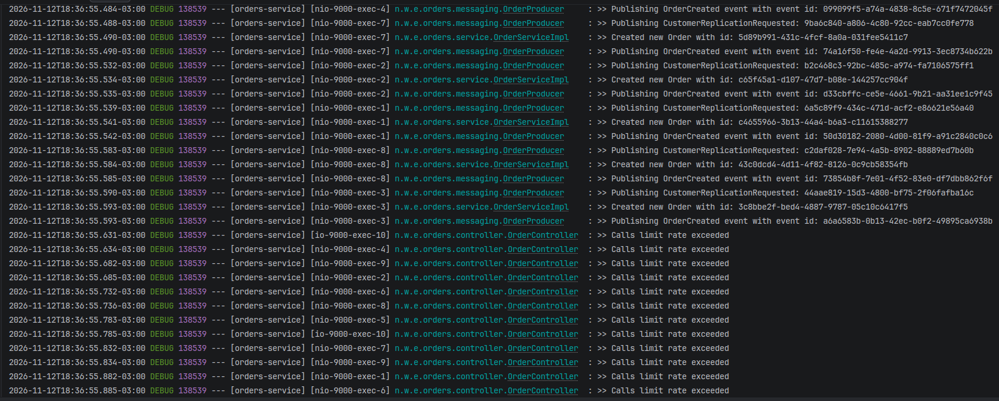

# Rate Limiter

## Introduction

Imagine your microservices architecture is like a popular nightclub, and a rate limiter is the
bouncer standing at the front door. No matter how much people want to get inside, the club only has
so much room. Without someone managing the line, the place gets overcrowded, the bar runs out of
drinks, and the whole night turns into chaos.
In software, a rate limiter is a simple gatekeeper that controls how much traffic a service can
handle over a specific period. Instead of letting every single request rush in at once, it checks
the incoming flow—usually by tracking an IP address, a user ID, or an API key—and decides whether to
let the request through or temporarily turn it away. If someone hits the limit, the gatekeeper
politely hands them a "come back later" sign (typically an HTTP 429 error) until their timer resets.
Using a rate limiter helps you avoid a few major headaches:

- **Server meltdowns**: It stops sudden traffic spikes from crashing your system or slowing it down to a
  crawl.
- **Noisy neighbors**: It prevents one overly eager user or a buggy script from hogging all your
  resources and ruining the experience for everyone else.
- **Malicious attacks**: It acts as a first line of defense against bots, brute-force password guessing,
  and denial-of-service (DoS) floods.
- **Surprise cloud bills**: It keeps runaway traffic from automatically scaling up your servers and
  draining your budget overnight.
  In a microservices setup, where dozens of small services constantly talk to each other, a rate
  limiter isn't just a nice-to-have—it is essential for survival. Because microservices rely on one
  another, a traffic jam in one tiny service can quickly trigger a domino effect, taking down the
  entire application. By putting rate limiters in place, you isolate problems, keep your system
  predictable, and guarantee a smooth, reliable experience for your users, even when things get
  busy.

In this article I will be showing with a little practical example, how it can be implemented with
the Resillience4J Rate Limiter implementation.

## Implementation aspects

For Spring Boot 4, I’d add a **Resilience4j rate limiter inside `orders-service`**, scoped to order
creation at `POST /api/v1/orders`.\
The controller can ask a named limiter for permission before calling `OrderService.create`. If the
limit is reached, it should return **HTTP 429 Too Many Requests** and not create the order. The
limiter would be configured in `application.yml`, so its rate and refresh period can be changed
without editing code.\
The limiter would be **per running instance**. For example, if configured for 10 permits per second
and the service has three instances, they could collectively allow up to about 30 requests per
second. That trade-off is fine for a service-local limit, but it should be documented and revisited
if the service is scaled horizontally.

## Changes to the existing project

### 1. Add Resilience4j’s core dependency

For example, in `pom.xml`:

```xml

<dependency>
  <groupId>io.github.resilience4j</groupId>
  <artifactId>resilience4j-ratelimiter</artifactId>
  <version>${resilience4j.version}</version>
</dependency>
```

I’d define the version in Maven properties after verifying which Resilience4j release is compatible
with the Spring Boot 4 / Java 21 setup. Using the core module avoids relying on Spring annotations
or an integration starter.

### 2. Configure a limiter in `application.yml`

```yaml
app:
  rate-limiting:
    orders:
      limit-for-period: 10
      limit-refresh-period: 1s
      timeout-duration: 0
```

That example allows ten order creations per one-second period per service instance. A zero timeout
means requests that cannot get a permit immediately are rejected rather than queued.

### 3. Create the limiter as a Spring bean

```java

@Configuration
public class RateLimiterConfiguration {

  @Bean
  RateLimiter orderCreationRateLimiter(
      @Value("${app.rate-limiting.orders.limit-for-period}") int limit,
      @Value("${app.rate-limiting.orders.limit-refresh-period}") Duration refreshPeriod,
      @Value("${app.rate-limiting.orders.timeout-duration}") Duration timeout) {

    RateLimiterConfig config = RateLimiterConfig.custom()
        .limitForPeriod(limit)
        .limitRefreshPeriod(refreshPeriod)
        .timeoutDuration(timeout)
        .build();

    return RateLimiter.of("orderCreation", config);
  }
}
```

### 4. Reject excess requests before creating an order

In `OrderController.create`, check the limiter before calling the service. If it denies a permit,
return `429 Too Many Requests`; otherwise continue with the existing create flow and `201 Created`
response.

I’d use the core API directly for this first version, which keeps the limiter explicit and doesn’t
depend on the annotation-based Spring integration. The exact controller code would depend on how we
want to represent the 429 response, but the behavior should be covered by a controller test.

This is still a **per-instance** limit. With three instances and a limit of ten per second, the
aggregate could reach roughly thirty per second.

## Testing

I created a JMeter test with 20 user threads firing 2 `order-create` POST requests each.\
The limiter is configured for accepting 10req/ms.\
The logs output shows the results.
<p style="text-align: center">
  
</p>